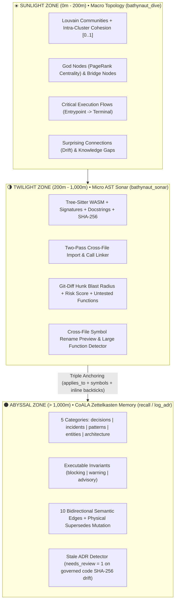

<div align="center">

# 🌊 Bathynaut

### The Unified Oceanic Cognitive Architecture, Code Graph & Zettelkasten Memory Harness for AI Coding Agents

<p align="center">
  <a href="https://github.com/miguelarc/bathynaut"></a>
  <a href="https://opensource.org/licenses/MIT"></a>
  <a href="https://nodejs.org">= 18"></a>
  <a href="https://www.typescriptlang.org"></a>
  <a href="https://modelcontextprotocol.io"></a>
  
</p>

<p align="center">
  <strong>Stop letting your AI coding agent drown in tokens or suffer architectural amnesia across sessions.</strong><br>
  Bathynaut unifies a <b>Tree-sitter WASM Call & Import Graph</b>, <b>Louvain Topological Clustering + PageRank</b>, and a <b>CoALA Zettelkasten Causal Memory Vault</b> (ADRs, Incidents, Patterns, Entities, Invariants) into <b>one local SQLite file (<code>ocean.db</code>)</b> and <b>one MCP server</b>.
</p>

<p align="center">
  <sub>Works out of the box with <b>Antigravity</b> · <b>Claude Code</b> · <b>Cursor</b> · <b>Windsurf</b> · <b>GitHub Copilot</b> · <b>Gemini CLI</b> · <b>OpenCode</b> · <b>Codex</b></sub>
</p>

<p align="center">
  <a href="#-let-your-ai-agent-install--configure-it-zero-touch">🤖 One-Prompt Agent Setup</a> ·
  <a href="#-quick-start-30-seconds">⚡ Quick Start</a> ·
  <a href="#-why-bathynaut-compared-with-the-ecosystem">🏆 Ecosystem Comparison</a> ·
  <a href="#-the-oceanic-7-mcp-tools">🎯 MCP Tools</a> ·
  <a href="#-universal-multi-agent-harness">🪝 Hooks, Skills & Rules</a> ·
  <a href="#-3-column-ocean-canvas-ide-explorer">🖥️ Visual Explorer</a> ·
  <a href="#-cli-reference">🛠️ CLI Reference</a>
</p>

</div>

---

## 🤖 Let Your AI Agent Install & Configure It (Zero-Touch)

Don't want to configure anything manually? Copy and paste the block below directly into **Antigravity**, **Claude Code**, **Cursor**, **Windsurf**, **GitHub Copilot**, or **OpenCode**. Your agent will install Bathynaut, wire up its own MCP server, hooks, rules, and skills, build the AST + Zettelkasten graph, and map your project's architecture automatically:

<details open>
<summary><b>📋 Copy-Paste Self-Setup Prompt for Any AI Coding Agent (Português / English)</b></summary>

```markdown
Quero que você instale, configure e inicialize o **Bathynaut** (Unified Oceanic Cognitive Architecture & Memory Harness) neste repositório de forma 100% autônoma seguindo os passos abaixo:

1. **Instalação & Inicialização em 1 Comando**:
   - Se o pacote `bathynaut` já estiver publicado ou disponível via npm, execute na raiz deste projeto:
     `npx bathynaut init -d "."`
   - Caso estejamos usando o repositório local do Bathynaut (ex: `d:/projetos/bathynaut`), faça o build dele (`npm --prefix "d:/projetos/bathynaut" run build`) e execute:
     `node "d:/projetos/bathynaut/dist/cli/main.js" init -d "."`

2. **Verificação da Infraestrutura Criada**:
   Confirme que o comando `init` gerou e configurou automaticamente:
   - Cofre Zettelkasten CoALA em `.bathynaut/memory/` (`activeContext.md`, `index.md`, `wiki/decisions`, `wiki/incidents`, `wiki/patterns`, `wiki/entities`, `wiki/architecture`, `raw/`).
   - Banco de grafo unificado `.bathynaut/ocean.db` e explorador interativo `.bathynaut/bathynaut.html`.
   - Regras nativas com Context Includes (`AGENTS.md`, `GEMINI.md`, `.agents/rules/bathynaut.md`, `CLAUDE.md`, `.cursor/rules/bathynaut.mdc`).
   - 6 Cognitive Skills em `.agents/skills/bathynaut-*`, `.claude/skills/bathynaut-*` e `.cursor/skills/bathynaut-*`.
   - Agent Lifecycle Hooks (`SessionStart` e `PreToolUse`) em `.agents/hooks.json`, `.claude/settings.json` e `.cursor/hooks.json`, além dos Git hooks (`post-merge`, `post-commit`, `post-checkout`).

3. **Auditoria de Saúde e Mapeamento Arquitetural Inicial**:
   - Execute `bathynaut doctor` (ou a tool MCP `bathynaut_lint({})` / `bathynaut_dive({})`) para inspecionar as Comunidades Louvain, os God Nodes (PageRank), os Execution Flows, as `surprising_connections` e os `knowledge_gaps`.
   - Liste todos os arquivos que foram criados/modificados e me apresente um resumo executivo da topologia descoberta neste projeto.
```

</details>

---

## ⚡ Quick Start (30 Seconds)

```bash
cd your-project
npx bathynaut init
```

In a single command, `bathynaut init`:
1. **Scaffolds the CoALA Zettelkasten Vault** (`.bathynaut/memory/` — or seamlessly adopts an existing `.agents/memory/` vault) with 5 cognitive categories and pre-configured Obsidian Graph View colors (`.obsidian/graph.json`).
2. **Detects & Configures 7 AI Agents** (**Antigravity**, **Claude Code**, **Cursor**, **Windsurf**, **GitHub Copilot**, **Gemini CLI**, **OpenCode**), creating safe `.bak` backups in `.bathynaut/backups/` before touching any file.
3. **Installs 6 Auto-Discovered Skills & Lifecycle Hooks** (`SessionStart` to inject hot session memory and `PreToolUse` to guard files governed by `blocking` ADRs).
4. **Builds the Unified Code + Memory Graph (`ocean.db`)** via `web-tree-sitter` (WASM) with Two-Pass Cross-File Symbol & Import Resolution, traces **Execution Flows**, computes **PageRank God Nodes** & **Louvain Cohesion**, and exports the interactive 3-column IDE explorer (`.bathynaut/bathynaut.html`).

### Start Here: What Do You Want to Do?

| You want to... | Terminal Command | Or ask your AI Agent |
| :--- | :--- | :--- |
| **Set up Bathynaut in a repository** | `npx bathynaut init` | *"Run bathynaut init in this repo"* |
| **Sync code + memory incrementally (`<50ms` warm)** | `npx bathynaut map` | Automatic on every MCP call (`ensureFreshGraph`) & Git commit/merge |
| **Audit blast radius & invariants before commit/PR** | `npx bathynaut review` | *"Use `bathynaut-review-changes` to review my uncommitted diff"* |
| **Open the 3-Column Visual Graph & Glob Simulator** | `npx bathynaut explore` | *"Open the Bathynaut Ocean Canvas explorer"* |
| **Map the 6 critical domains & fill knowledge gaps** | — | *"Run the `bathynaut-map-project` skill on this codebase"* |
| **Compile raw notes/RFCs from `raw/` into ADRs** | — | *"Run `bathynaut-wiki-compile` on pending raw sources"* |
| **Check 5D graph health (orphans, stale ADRs, broken links)** | `npx bathynaut doctor` | *"Run `bathynaut-wiki-lint` and fix any graph issues"* |
| **Save hot session progress before clearing context** | — | *"Run `bathynaut-session-checkpoint`"* |
| **Undo all agent configs/hooks (keeping your memory vault)** | `npx bathynaut disconnect` | *"Disconnect Bathynaut from agent configs"* |

---

## 🏆 Why Bathynaut? (Compared with the Ecosystem)

Previously, getting full structural and causal intelligence required gluing together **three separate tools** across Python and Node.js (`code-review-graph` + `graphify` + `zk-wiki-mcp`), exposing **51 fragmented MCP tools** that bloated the LLM prompt and stored disconnected graphs.

**Bathynaut** replaces the entire stack with **1 TypeScript binary**, **1 SQLite database (`ocean.db`)**, and **7 orthogonal MCP tools**:

| Capability | `zk-wiki-mcp` | `code-review-graph` | `graphify` | `graphicle` | **🌊 Bathynaut SOTA** |
| :--- | :---: | :---: | :---: | :---: | :---: |
| **Runtime & Zero-Friction Install** | TypeScript | Python 3.10+ (`uv`/`pipx`) | Python 3.10+ | Rust binary | **100% TypeScript / Node.js (`npx`, WASM + `better-sqlite3` / `node:sqlite` fallback)** |
| **MCP Tool Footprint (Prompt Overhead)** | 5 tools | 28 tools | 10 tools | 8 tools | **7 Orthogonal High-Density Tools (`sonar`, `dive`, `path`, `recall`, `log_adr`, `checkpoint`, `lint`)** |
| **Cross-File AST Call & Import Resolution** | ❌ None | ✅ Strong | ⚠️ Partial | ✅ Strong | **✅ Two-Pass Symbol & Import Linker (`EXTRACTED` / `INFERRED`)** |
| **Execution Flow Tracing (Entrypoint → Leaf)** | ❌ None | ✅ `flows` | ❌ No | ❌ No | **✅ Criticality-Scored Execution Flows + `flow_memberships`** |
| **Git Diff Line-Level Blast Radius + Risk Score** | ❌ None | ✅ Yes | ⚠️ Basic PR | ✅ Yes | **✅ `git diff --unified=0` Hunk Mapping + Risk Score `[0..1]` + Untested Functions** |
| **Macro Topology, Drift & Knowledge Gaps** | ❌ None | ⚠️ Basic | ✅ Strong | ✅ Strong | **✅ Louvain Cohesion + Bridge Nodes + `surprising_connections` + `knowledge_gaps`** |
| **Causal Memory (CoALA + Zettelkasten + ADRs)** | ✅ Strong (4 cats) | ❌ None | ⚠️ Flat Wiki | ⚠️ Flat notes | **✅ 5-Category CoALA Vault + 10 Bidirectional Semantic Edges + Dual-Vault** |
| **Physical `.md` Frontmatter Mutation on `supersedes`** | ✅ Yes | ❌ None | ❌ None | ❌ None | **✅ Rewrites Old `.md` on Disk (`status: superseded` + `superseded_by`) + SQLite** |
| **Declarative Upsert (`id`), `sources` (`raw/`) & Batch `ids`** | ✅ Yes | ❌ None | ❌ None | ❌ None | **✅ Full Parity (`id`, `sources`, `uncompiled_raw_sources`, `ids` batch read)** |
| **Executable Invariants & Active PreToolUse Guard** | ❌ None | ❌ None | ❌ None | ❌ None | **✅ `blocking \| warning \| advisory` + `<15ms` `PreToolUse` Hook Guard** |
| **Triple Code-ADR Anchoring & Stale ADR Detection** | ⚠️ Glob only | ❌ None | ❌ None | ⚠️ Symbol only | **✅ `applies_to` Globs + `symbols` Frontmatter + `` `backtick()` `` Inline + SHA-256 Stale Flag** |
| **Deterministic Symbol Rename Preview & Large Functions** | ❌ None | ✅ `refactor_tool` | ❌ None | ❌ None | **✅ `rename_symbol` Cross-File Caller Preview + `large_functions` Detector** |
| **Search Engine** | FTS5 BM25 | FTS5 | Substring | BM25 + RRF | **✅ Hybrid RRF (FTS5 BM25 + Identifier Splitting + PageRank + Backlinks + `cross_repo`)** |
| **3-Column IDE Visual Debugger (`bathynaut.html`)** | ✅ 3-Column | ❌ None | ⚠️ 1-Panel | ✅ Web App | **✅ 3-Column IDE (Sonar Glob Simulator + Animated Particles + Breadcrumbs + Health Modal)** |

---

## 🧭 Architecture: The 3 Oceanic Depth Zones



---

## 🎬 See It in Action (Real Outputs)

### 1. Pre-Commit / Pre-PR Blast Radius & Invariant Audit (`npx bathynaut review`)
```text
$ npx bathynaut review src/auth.ts

🚨 [Bathynaut Review] Risk Level: HIGH (Score: 0.68)
   • Arquivos Alvo (1): src/auth.ts
   • Simbolos Modificados (2): validateToken, requireAuth
   • Blast Radius (6 simbolos em 3 arquivos)
   • Fluxos de Execucao Afetados (2): handleCheckout -> requireAuth -> validateToken
   • Testes de Cobertura (1): tests/auth.spec.ts#testJwtValidation
   ⚠️ Funcoes sem Cobertura de Teste (1): refreshSessionToken

🛑 BLOCKING INVARIANTS ATIVOS (1):
   • [adr-002-stateless-jwt] Nunca aceitar tokens HS256; exigir assinatura Ed25519 validada.
```

### 2. Active Lifecycle Hook Guard (`PreToolUse` on `edit_file` / `write_file`)
When an agent attempts to edit a file governed by an active ADR, `bathynaut hook-guard` intercepts the tool call in `<15ms` and injects the governing invariants directly into the agent's context:
```json
{
  "hookSpecificOutput": {
    "hookEventName": "PreToolUse",
    "additionalContext": "⚠️ [Bathynaut Sonar Guard] Invariantes ativos governando src/payment.ts:\n- [BLOCKING] adr-001-idempotency-key (Exigir Idempotency Key em Cobrancas): Nunca processar cobranca sem idempotencyKey validada"
  }
}
```

---

## 🧠 CoALA Cognitive Ontology & 10 Bidirectional Semantic Edges

Grounded in **CoALA (Cognitive Architectures for Language Agents, Sumers et al., 2024)**, **MADR v4**, and **Nygard ADRs**, Bathynaut organizes project memory into **4 Memory Systems** and **5 Zettelkasten Categories**:

### 1. Directory Layout (`.bathynaut/memory/` or `.agents/memory/`)
```text
.bathynaut/
├── ocean.db                  # Unified SQLite graph (AST + Topology + FTS5 + Zettelkasten)
├── bathynaut.html            # Self-contained 3-Column IDE Ocean Canvas Explorer
├── backups/                  # Automatic .bak backups of agent configs & rules
└── memory/
    ├── activeContext.md      # Episodic Working Memory (current session state & next tasks)
    ├── index.md              # Auto-generated Map of Content (MOC) grouped by category & alerts
    ├── raw/                  # Uncompiled RFCs, logs & notes (tracked by uncompiled_raw_sources)
    ├── .obsidian/graph.json  # Pre-configured Obsidian color groups for all 5 categories
    └── wiki/
        ├── decisions/        # kind: adr          (Architectural Decision Records & invariants)
        ├── incidents/        # kind: incident     (Postmortems, root causes & regressions)
        ├── patterns/         # kind: pattern      (Idiomatic conventions & anti-patterns)
        ├── entities/         # kind: entity       (Core domain models & bounded contexts)
        └── architecture/     # kind: architecture (High-level subsystem & community specs)
```

### 2. The 10 Bidirectional Semantic Relations
Every semantic edge declared in YAML frontmatter (`edges: { mitigates: [...] }`) or inline Dataview syntax (`mitigates:: [[inc-001]]`) automatically materializes its **inverse backlink** in `bathynaut_recall`:

| Forward Relation (`source -> target`) | Inverse Backlink (`target <- source`) | Engineering Semantics |
| :--- | :--- | :--- |
| **`supersedes`** | `superseded_by` | Temporal ADR lineage; **physically updates old `.md` file** (`status: superseded` + `superseded_by`). |
| **`mitigates`** | `mitigated_by` | Connects a decision or pattern to the incident/vulnerability it prevents. |
| **`caused_by`** | `caused_incident` | Connects an incident to the root-cause symbol or legacy decision. |
| **`depends_on`** | `required_by` | Structural or architectural dependency between decisions, patterns, or modules. |
| **`implements`** | `implemented_by` | Links concrete patterns or modules to the architectural specification they realize. |
| **`tensions_with`** | `tensions_with` | Explicit architectural trade-off tension (e.g., Latency vs. Consistency). |
| **`verified_by`** | `verifies` | Connects an ADR invariant to the automated test suite enforcing it. |
| **`mentions`** | `mentioned_in` | Standard `[[wikilink]]` with extracted surrounding paragraph context snippet. |
| **`shares_scope_with`** | `shares_scope_with` | Auto-inferred (`INFERRED`) when two active notes share overlapping `applies_to` globs. |
| **`governed_by`** | `governs` | Triple-anchored bridge between physical AST code symbols and Zettelkasten notes. |

### 3. Triple Code-to-ADR Anchoring & Stale ADR Detection
Bathynaut links physical code symbols (`function`, `class`, `interface`, `file`) to Zettelkasten notes via **3 automatic anchors**:
1. **File Globs (`applies_to`)**: e.g., `applies_to: ["src/auth/**"]` (`INFERRED`).
2. **Explicit Symbol Anchors (`symbols`)**: e.g., `symbols: ["validateToken", "AuthService.login"]` (`EXTRACTED`).
3. **Inline Backtick Code Mentions**: Mentioning `` `validateToken()` `` in the Markdown body automatically links the note to the AST node (`INFERRED`).

When a governed function's AST `content_hash` (SHA-256) changes in code without updating its governing ADR, Bathynaut marks the edge with `needs_review = 1` (`stale_warning: true`), surfacing it in `bathynaut_sonar` and `bathynaut_lint`.

---

## 🎯 The "Oceanic 7" MCP Tools

| MCP Tool | Key Parameters | What It Returns |
| :--- | :--- | :--- |
| **`bathynaut_sonar`** | `files`, `git_diff`, `token_budget`, `include_large_functions`, `min_lines`, `rename_symbol`, `project_path` | **Pre-Edit Radar**: `blocking_invariants` at the top, `risk_score` (`0..1`) + `risk_level`, `affected_nodes` (callers/callees), `affected_flows`, `covering_tests`, `untested_functions`, `governing_adrs`, `known_incidents`, `large_functions`, `rename_preview`, and token-packed `excerpts`. |
| **`bathynaut_dive`** | `community_id`, `query`, `project_path` | **Macro Topology**: Louvain `communities` (with intra-cluster `cohesion`), `top_god_nodes` (PageRank), `bridge_nodes`, `top_flows`, `surprising_connections` (architectural drift), and `knowledge_gaps` (undocumented communities). |
| **`bathynaut_path`** | `from`, `to`, `project_path` | **Acoustic Pathfinding**: Bidirectional BFS shortest path connecting any two code symbols or Zettelkasten notes with edge relations and confidence tiers (`EXTRACTED` / `INFERRED`). |
| **`bathynaut_recall`** | `query`, `ids`, `category`, `include_superseded`, `cross_repo`, `limit`, `token_budget`, `project_path` | **Hybrid RRF & Batch Reader**: Combines FTS5 BM25 (with `camelCase`/`snake_case` splitting) + PageRank + 1-Hop outgoing edges & inverse backlinks. Supports direct batch read via `ids: [...]` (`wiki_read_compiled` parity) and federated `cross_repo` search across `~/.bathynaut/registry.json`. |
| **`bathynaut_log_adr`** | `id`, `title`, `summary`, `category`, `context`, `decision`, `enforcement`, `invariants`, `applies_to`, `symbols`, `sources`, `edges`, `auto_generate_architecture_notes` | **CoALA Atomic Compiler**: Compiles/upserts validated Markdown notes, mutates superseded `.md` files on disk, tracks compiled `raw/` `sources`, auto-interlinks matching code AST nodes in SQLite, and regenerates `index.md`. |
| **`bathynaut_checkpoint`** | `summary`, `active_tasks`, `decisions` | **Episodic Session Memory**: Persists hot working state to `activeContext.md` so the next session starts with full continuity. |
| **`bathynaut_lint`** | `project_path` | **5D Graph Health Audit**: Reports `orphan_active_notes` (and `orphan_nodes`), `dangling_links` (and `broken_edges`), `stale_adrs`, `untested_god_nodes`, and `uncompiled_raw_sources` (distinguishing compiled vs. uncompiled files in `raw/`). |

> **Zero-Configuration Multi-Project Routing**: Every MCP tool automatically infers the target workspace from `project_path`, `workspace_hint`, or any absolute path passed in `files`, `applies_to`, or `sources`, routing through an LRU `ProjectContextPool` and running `<50ms` Just-in-Time incremental sync (`ensureFreshGraph`).

---

## 🤖 Universal Multi-Agent Harness (Hooks, Skills, Rules & MCP)

Running `npx bathynaut init` configures the entire cognitive harness across 7 major AI coding platforms with automatic `.bak` backups and clean 1-command rollback (`npx bathynaut disconnect`):

| Agent Platform | MCP Server Config (`-d <repo>` pinned) | Rules & Progressive Disclosure Includes | Auto-Discovered Skills (6 Workflows) | Agent Lifecycle & Git Hooks |
| :--- | :--- | :--- | :--- | :--- |
| **Antigravity** | `~/.gemini/antigravity/mcp_config.json` | `AGENTS.md`, `GEMINI.md`, `.agents/rules/bathynaut.md` (with `@[Contexto Ativo](.bathynaut/memory/activeContext.md)` & `@[Indice da Wiki](.bathynaut/memory/index.md)`) | `.agents/skills/bathynaut-*/SKILL.md` | `.agents/hooks.json` (`SessionStart`, `PreToolUse`) |
| **Claude Code** | `.mcp.json` (project) + `~/.claude.json` | `CLAUDE.md` (with `@.bathynaut/memory/activeContext.md` & `@.bathynaut/memory/index.md`) | `.claude/skills/bathynaut-*/SKILL.md` | `.claude/settings.json` (`SessionStart`, `PreToolUse`) |
| **Cursor** | `.cursor/mcp.json` | `.cursor/rules/bathynaut.mdc` (`alwaysApply: true`, `globs: "**/*"`) + `.cursorrules` | `.cursor/skills/bathynaut-*/SKILL.md` | `.cursor/hooks.json` (`beforeShellExecution`) |
| **Windsurf** | `~/.codeium/windsurf/mcp_config.json` | `.windsurfrules` + `AGENTS.md` | `.agents/skills/bathynaut-*/SKILL.md` | Git `post-merge`, `post-commit`, `post-checkout` |
| **GitHub Copilot** | `.vscode/mcp.json` (`"servers"` + `"type": "stdio"`) | `.github/copilot-instructions.md` | `.agents/skills/bathynaut-*/SKILL.md` | Git `post-merge`, `post-commit`, `post-checkout` |
| **Gemini CLI** | `.gemini/settings.json` | `GEMINI.md` | `.agents/skills/bathynaut-*/SKILL.md` | `.gemini/settings.json` (`SessionStart`, `PreToolUse`) |
| **OpenCode / Codex** | `opencode.json` (`"mcp"` local) | `AGENTS.md` | `.agents/skills/bathynaut-*/SKILL.md` | Git `post-merge`, `post-commit`, `post-checkout` |

### The 6 Built-In Cognitive Skills
1. **`bathynaut-map-project`**: 6-Domain Deep Architecture & CoALA Zettelkasten Mapping (`bathynaut_dive` + `bathynaut_log_adr` + `bathynaut_lint`).
2. **`bathynaut-wiki-compile`**: Compiles raw documents from `.bathynaut/memory/raw/` into atomic Zettelkasten notes with `sources` and typed edges.
3. **`bathynaut-wiki-lint`**: 5D Graph Health Audit (`orphan_active_notes`, `dangling_links`, `stale_adrs`, `untested_god_nodes`, `uncompiled_raw_sources`).
4. **`bathynaut-session-checkpoint`**: Persists hot episodic session state (`activeContext.md`) & compiles session learnings.
5. **`bathynaut-review-changes`**: Pre-commit / PR Blast Radius & Risk Score Review (`bathynaut_sonar({ git_diff: "HEAD" })`).
6. **`bathynaut-refactor-safely`**: Safe Cross-File Symbol Refactoring & `blocking_invariants` Verification.

---

## 🖥️ 3-Column Ocean Canvas IDE Explorer (`bathynaut.html`)

Run `npx bathynaut explore` to open the self-contained, zero-server interactive visual debugger in your browser:

- **Left Sidebar (Filters, Tree & Sonar Glob Simulator)**:
  - Filter by Depth Zone (`Sunlight`, `Twilight`, `Abyssal`) or Community.
  - **🎯 Sonar Glob Simulator**: Type any file path (e.g., `src/mcp/server.ts`) to highlight all ADRs, patterns, and incidents whose `applies_to` globs govern that file in real time.
- **Center Interactive D3.js Canvas**:
  - Force-directed topology with **Community Hulls**, **PageRank-scaled node radii**, **dashed gold halos for Bridge Nodes**, and **animated directional particles** flowing along directed edges.
  - **1-Hop / 2-Hop / Full Graph** focus toggle, **Back / Forward navigation history**, interactive **Breadcrumb trail**, and **🩺 Health Audit Modal**.
- **Right Inspector Drawer (Full Markdown + AST Reader)**:
  - Displays full formatted Markdown body with clickable `[[wikilink]]` chips, AST signatures, executable `invariants`, `applies_to` globs, outgoing semantic edges, and inverse backlinks.

---

## 🛠️ CLI Reference

```bash
# 1. Initialize vault, agent rules, skills, lifecycle hooks, MCP config, and map repository
npx bathynaut init [-d <dir>]

# 2. Incremental AST + Zettelkasten sync (<50ms warm; --force for full rebuild)
npx bathynaut map [-d <dir>] [--force]

# 3. Pre-commit / Pre-PR Risk & Blast Radius Audit (supports Git diff refs)
npx bathynaut review [files...] [-d <dir>] [--base HEAD] [--token-budget 2500] [--json]

# 4. Launch the interactive 3-Column D3.js Ocean Canvas Explorer in your browser
npx bathynaut explore [-d <dir>]

# 5. Run the 5D Graph & Memory Health Audit
npx bathynaut doctor [-d <dir>]

# 6. Install or remove Git hooks + Agent Lifecycle Hooks
npx bathynaut hooks [install|uninstall] [-d <dir>]

# 7. Fast (<15ms) Agent Lifecycle Hook evaluator (invoked automatically by SessionStart / PreToolUse)
npx bathynaut hook-guard --event <SessionStart|PreToolUse> [-d <dir>]

# 8. Safely remove injected agent rules, skills, hooks & MCP entries while preserving .bathynaut/memory/
npx bathynaut disconnect [-d <dir>]

# 9. Run the MCP server over stdio
npx bathynaut serve [-d <dir>]
```

---

## 🔒 Privacy, Zero-API-Cost & FAQ

<details>
<summary><b>Does Bathynaut require an OpenAI / Anthropic / Gemini API key?</b></summary>

**No.** Bathynaut is 100% local and deterministic. Tree-sitter WASM parses your code, Louvain and PageRank compute the topology, and SQLite FTS5 + Hybrid RRF power the search. Nothing ever leaves your machine, and there is zero API cost.
</details>

<details>
<summary><b>What happens if my environment lacks C++ build tools for <code>better-sqlite3</code>?</b></summary>

Bathynaut includes an automatic zero-dependency adapter (`src/storage/db.ts`) that seamlessly falls back to Node.js's built-in `node:sqlite` (`DatabaseSync` in Node 22+) if `better-sqlite3` native bindings are unavailable.
</details>

<details>
<summary><b>Can I use Bathynaut on a project that already has an <code>.agents/memory/</code> vault from <code>zk-wiki-mcp</code>?</b></summary>

**Yes!** Bathynaut's Dual-Vault resolver (`resolveMemoryVault`) automatically detects and adopts an existing `.agents/memory/` directory without moving or breaking your existing Zettelkasten notes, and remains 100% compatible with Obsidian.
</details>

---

## 📄 License

MIT © Miguel Arc & Antigravity
