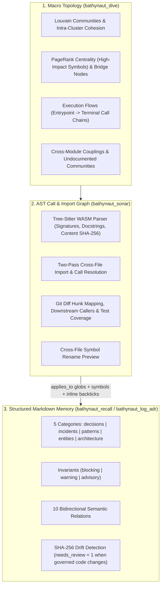
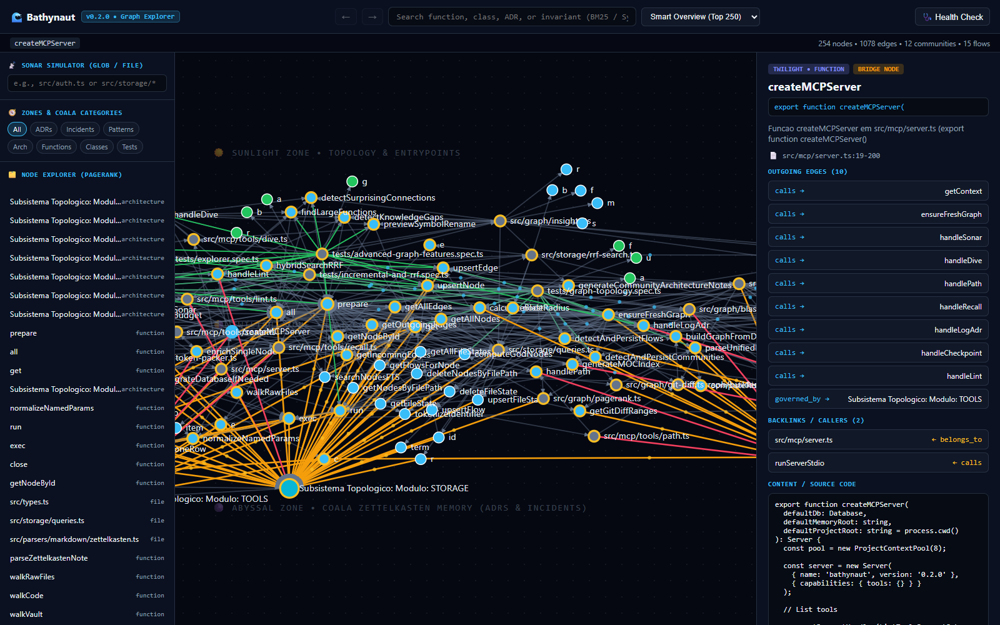

<p align="center">
  
</p>

# Bathynaut

> **Stop AI coding agents from breaking your architecture or forgetting past technical decisions.**

**Local AST code graph, topological analyzer, and ADR/Zettelkasten memory server (MCP) for AI coding agents.**

[English](README.md) | [Português (Brasil)](README.pt-BR.md)

[](https://github.com/miguelarcjr/bathynaut)
[](LICENSE)
[-16a34a?style=flat-square)](https://nodejs.org)
[](https://www.typescriptlang.org)
[](https://modelcontextprotocol.io)

---

## Contents

- [Overview & Design Goals](#overview--design-goals)
- [Quick Start](#quick-start)
- [Architecture](#architecture)
- [Memory Vault & Semantic Relations](#memory-vault--semantic-relations)
- [MCP Tools Reference](#mcp-tools-reference)
- [Agent Harness Integration (Rules, Skills & Hooks)](#agent-harness-integration-rules-skills--hooks)
- [Visual Graph Explorer (`bathynaut.html`)](#visual-graph-explorer-bathynauthtml)
- [CLI Reference](#cli-reference)
- [Technical FAQ](#technical-faq)
- [License](#license)

---

## Overview & Design Goals

### The Problem Bathynaut Solves

When an AI coding agent (Antigravity, Claude Code, Cursor, Windsurf, Copilot) edits a file in a non-trivial repository, it faces two critical blindspots:
1. **Structural Blindness**: Grepping files or reading isolated chunks does not reveal which transitive callers, execution flows, or tests will break downstream before an edit is made.
2. **Session Amnesia**: Architectural trade-offs, security invariants, and past bug postmortems documented in Markdown are rarely linked to the specific functions or files they govern—causing agents to repeatedly reintroduce resolved issues.

### How Bathynaut Solves It (In 1 Command)

Bathynaut equips your AI agent with **local structural awareness** and **persistent causal memory** through standard Model Context Protocol (MCP) tools and lifecycle hooks:

- 📡 **Pre-Edit Radar (`bathynaut_sonar`)**: Before saving an edit, the agent automatically receives the AST blast radius, affected call chains, test coverage, and active architectural invariants (`blocking_invariants`).
- 🗺️ **Subsystem Topology (`bathynaut_dive`)**: Maps functional module clusters (Louvain communities) and high-centrality gravity centers (PageRank God Nodes) so the agent respects subsystem boundaries instead of introducing cross-layer coupling.
- 🧠 **Living ADR Memory (`bathynaut_recall` / `bathynaut_log_adr`)**: Links architectural decision records (ADRs), patterns, and incident postmortems directly to code symbols (`applies_to`, `symbols`, and inline `` `symbol()` `` mentions) with automatic drift detection (`needs_review`).

### What You Gain in Practice

- ⚡ **Lower token usage and faster turns**: Instead of burning dozens of `grep` and full-file read calls trying to trace dependencies, a single tool call returns exact signatures, callers, and governing decisions packed within a strict `token_budget`.
- 🛡️ **Safer refactors and fewer regressions**: The agent sees every downstream caller, risk score, and covering (or missing) test before modifying a function.
- 🔄 **Zero context re-prompting across sessions and IDEs**: Stop re-explaining architectural rules in every new chat—session state (`activeContext.md`) and blocking invariants travel with the repository across Antigravity, Claude Code, Cursor, Windsurf, Gemini CLI, and Copilot.
- 📐 **Documentation that never silently rots**: Because ADRs are anchored to AST nodes, modifying a governed function automatically flags the decision with `needs_review`.

**100% deterministic, offline, and private.** Zero external API calls and zero arbitrary vector chunks—everything lives in a single local SQLite database (`.bathynaut/ocean.db`) powered by `web-tree-sitter` (WASM), FTS5 BM25 + PageRank hybrid search, and pure TypeScript.

| Dimension | AST-Only Code Graphs | Markdown Memory Servers | Bathynaut |
| :--- | :--- | :--- | :--- |
| **Primary Focus** | Call/import graphs, clustering, blast radius | ADRs, session notes, wiki links | Unified AST graph + structured ADR/Zettelkasten memory |
| **Runtime** | Python (`uv`/`pipx`) or native binaries | Node.js or Python | Node.js / TypeScript (`web-tree-sitter` WASM + SQLite) |
| **MCP Tool Surface** | 10–28 tools | 4–8 tools | 7 consolidated tools (`sonar`, `dive`, `path`, `recall`, `log_adr`, `checkpoint`, `lint`) |
| **Code-to-Decision Linking** | None | File path globs only | File globs (`applies_to`), explicit `symbols`, and inline `` `symbol()` `` mentions |
| **Drift Detection** | AST re-indexing | Manual | Marks governing ADRs as `needs_review` when a governed symbol's SHA-256 changes |

---

## Quick Start

### 🤖 The Easiest Way: Automated Agent Setup Prompt

Just copy and paste the prompt below directly into your AI agent chat (Claude Code, Cursor, Antigravity, Windsurf, Copilot). Your agent will run the installation, verify all generated files, and configure its own MCP tools automatically:

<details open>
<summary><b>Copy-Paste Agent Setup Prompt (Click to collapse)</b></summary>

```markdown
Install and initialize Bathynaut in this repository by running the following steps:

1. Initialize:
   - Run `npx bathynaut init -d "."` in the repository root (or if using a local Bathynaut checkout, build it with `npm run build` and run `node <path-to-bathynaut>/dist/cli/main.js init -d "."`).

2. Verify generated files:
   - Memory vault in `.bathynaut/memory/` (or `.agents/memory/`) containing `activeContext.md`, `index.md`, and `wiki/{decisions,incidents,patterns,entities,architecture}`.
   - SQLite database `.bathynaut/ocean.db` and HTML viewer `.bathynaut/bathynaut.html`.
   - Agent rules (`AGENTS.md`, `GEMINI.md`, `CLAUDE.md`, `.cursor/rules/bathynaut.mdc`), skills (`.agents/skills/bathynaut-*`), and hooks.

3. Run initial diagnostics:
   - Run `npx bathynaut doctor` (or call `bathynaut_lint` and `bathynaut_dive`) and summarize the detected modules, entrypoints, and any undocumented subsystems.
```

</details>

### Or Run Manually via CLI

```bash
cd your-project
npx bathynaut init
```

Running `bathynaut init` performs four steps:
1. **Initializes the Markdown memory vault** in `.bathynaut/memory/` (or adopts an existing `.agents/memory/` directory if present).
2. **Configures detected AI coding clients** (Antigravity, Claude Code, Cursor, Windsurf, GitHub Copilot, Gemini CLI, OpenCode), backing up any existing config files to `.bathynaut/backups/` before modification.
3. **Installs agent skills and hooks** (`SessionStart` for session context, `PreToolUse` for surfacing active invariants on edited files, and Git post-commit/post-merge hooks).
4. **Parses the repository into `.bathynaut/ocean.db`** and exports a standalone D3.js graph viewer at `.bathynaut/bathynaut.html`.

### Common Tasks

| Goal | CLI Command | Agent Prompt / Skill |
| :--- | :--- | :--- |
| Initialize a repository | `npx bathynaut init` | *"Run `bathynaut init` in this repository"* |
| Incrementally sync modified files | `npx bathynaut map` | Automatic on MCP calls and Git hooks |
| Check blast radius & invariants for a diff | `npx bathynaut review` | *"Use `bathynaut-review-changes` on my current diff"* |
| Open the local D3.js graph viewer | `npx bathynaut explore` | *"Run `npx bathynaut explore`"* |
| Document architecture & knowledge gaps | — | *"Run the `bathynaut-map-project` skill"* |
| Compile notes from `raw/` into structured ADRs | — | *"Run `bathynaut-wiki-compile`"* |
| Audit graph integrity (orphans, broken links, stale ADRs) | `npx bathynaut doctor` | *"Run `bathynaut-wiki-lint`"* |
| Save session state to `activeContext.md` | — | *"Run `bathynaut-session-checkpoint`"* |
| Remove injected rules, hooks, and MCP configs | `npx bathynaut disconnect` | *"Run `npx bathynaut disconnect`"* |

---

## Architecture

Bathynaut models a repository across three connected layers in a single SQLite graph (`ocean.db`):



### Incremental Synchronization

Rather than re-parsing the entire repository on every query, `ensureFreshGraph` compares each file's `mtime_ms` and byte size against the `file_state` table in SQLite, computing a SHA-256 hash only when timestamps differ and re-parsing only modified files.

---

## Memory Vault & Semantic Relations

### 1. Directory Structure

Markdown files remain the source of truth on disk; SQLite serves as a derived relational and FTS5 index:

```text
.bathynaut/
├── ocean.db                  # SQLite database (nodes, edges, FTS5 index, communities, flows)
├── bathynaut.html            # Standalone D3.js graph explorer
├── backups/                  # Automatic .bak copies of modified agent config files
└── memory/
    ├── activeContext.md      # Session working state and pending tasks
    ├── index.md              # Auto-generated Map of Content (MOC)
    ├── raw/                  # Uncompiled notes, RFCs, or incident logs
    ├── .obsidian/graph.json  # Optional Obsidian graph color configuration
    └── wiki/
        ├── decisions/        # Architectural Decision Records (kind: adr)
        ├── incidents/        # Postmortems and bug root causes (kind: incident)
        ├── patterns/         # Reusable conventions and anti-patterns (kind: pattern)
        ├── entities/         # Core domain models (kind: entity)
        └── architecture/     # Subsystem overviews (kind: architecture)
```

### 2. Bidirectional Semantic Edges

Edges can be declared in YAML frontmatter (`edges: { mitigates: ["inc-001"] }`) or inline in Markdown (`mitigates:: [[inc-001]]`). When queried via `bathynaut_recall`, both outgoing relations and inverse backlinks are returned:

| Forward Relation (`source -> target`) | Inverse Backlink (`target <- source`) | Purpose |
| :--- | :--- | :--- |
| `supersedes` | `superseded_by` | Replaces an older ADR and updates the target `.md` frontmatter (`status: superseded`). |
| `mitigates` | `mitigated_by` | Links a decision or pattern to the incident/bug it prevents. |
| `caused_by` | `caused_incident` | Links an incident to its underlying cause. |
| `depends_on` | `required_by` | Declares a dependency between decisions, patterns, or modules. |
| `implements` | `implemented_by` | Connects a concrete module or pattern to an architectural spec. |
| `tensions_with` | `tensions_with` | Records an explicit trade-off between two decisions. |
| `verified_by` | `verifies` | Links an ADR or invariant to a test file or test symbol. |
| `mentions` | `mentioned_in` | Standard `[[wikilink]]` reference with surrounding paragraph context. |
| `shares_scope_with` | `shares_scope_with` | Automatically inferred when two active notes have overlapping `applies_to` globs. |
| `governed_by` | `governs` | Connects AST code symbols to the ADRs/notes that govern them. |

### 3. Code-to-ADR Anchoring & Drift Detection

Bathynaut connects AST symbols (`function`, `class`, `interface`, `file`) to Markdown notes in three ways:
1. **File globs (`applies_to`)**: e.g., `applies_to: ["src/auth/**"]`.
2. **Explicit symbol names (`symbols`)**: e.g., `symbols: ["validateToken", "AuthService"]`.
3. **Inline code references**: Referencing `` `validateToken()` `` in a note's Markdown body links it to the corresponding AST node.

When a governed function's AST body changes (detected via its SHA-256 `content_hash`) without a corresponding update to the governing ADR, the `governed_by` edge is flagged with `needs_review = 1` and surfaced in `bathynaut_sonar` and `bathynaut_lint`.

---

## MCP Tools Reference

| Tool | Parameters | Description |
| :--- | :--- | :--- |
| **`bathynaut_sonar`** | `files`, `git_diff`, `token_budget`, `project_path` | **Pre-edit impact analysis**: Returns `blocking_invariants`, `risk_score` (`0..1`), downstream `affected_nodes`, `affected_flows`, `covering_tests`, `untested_functions`, `governing_adrs`, `known_incidents`, and code excerpts fitted to `token_budget`. |
| **`bathynaut_dive`** | `community_id`, `query`, `rename_symbol`, `new_name`, `project_path` | **Macro topology**: Returns Louvain `communities` (with intra-cluster `cohesion`), `top_god_nodes` (PageRank), `bridge_nodes`, `top_flows`, `surprising_connections`, `knowledge_gaps`, `large_functions`, and cross-file `rename_preview`. |
| **`bathynaut_path`** | `from`, `to`, `project_path` | **Shortest path**: Finds the shortest bidirectional path between any two symbols or notes, including edge relations and confidence levels (`EXTRACTED` / `INFERRED`). |
| **`bathynaut_recall`** | `query`, `ids`, `category`, `include_superseded`, `cross_repo`, `limit`, `token_budget`, `project_path` | **Hybrid search & batch reader**: Combines SQLite FTS5 BM25 (with `camelCase`/`snake_case` tokenization), PageRank, and 1-hop backlinks via Reciprocal Rank Fusion (RRF). Also supports direct batch lookup by `ids`. |
| **`bathynaut_log_adr`** | `id`, `title`, `summary`, `category`, `context`, `decision`, `enforcement`, `invariants`, `applies_to`, `symbols`, `sources`, `edges`, `project_path` | **Note compiler**: Writes or updates a Markdown note with validated YAML frontmatter, updates any superseded `.md` files on disk, links matching AST symbols in SQLite, and regenerates `index.md`. |
| **`bathynaut_checkpoint`** | `summary`, `active_tasks`, `decisions`, `project_path` | **Session checkpoint**: Writes the current working summary and next tasks to `activeContext.md`. |
| **`bathynaut_lint`** | `project_path` | **Graph & memory lint**: Reports `orphan_active_notes`, `dangling_links`, `stale_adrs`, `untested_god_nodes`, and `uncompiled_raw_sources`. |

### Example CLI Review & Hook Output

Running `npx bathynaut review` on modified files:
```text
$ npx bathynaut review src/auth.ts

🚨 [Bathynaut Review] Risk Level: HIGH (Score: 0.68)
   • Target Files (1): src/auth.ts
   • Blast Radius (6 symbols across 3 files)
   • Affected Execution Flows: 2
   • Covering Tests (1): tests/auth.spec.ts#testJwtValidation
   ⚠️ Untested Functions (1): refreshSessionToken
   🛑 Active Blocking Invariants:
      - [adr-002-stateless-jwt] Never accept HS256 tokens; enforce verified Ed25519 signatures.
```

When `PreToolUse` hooks are active, editing a file governed by an ADR injects a reminder into the agent context:
```json
{
  "hookSpecificOutput": {
    "hookEventName": "PreToolUse",
    "additionalContext": "⚠️ [Bathynaut Sonar Guard] Active invariants governing src/payment.ts:\n- [BLOCKING] adr-001-idempotency-key (Require Idempotency Key on Charges): Never process a charge without a validated idempotencyKey"
  }
}
```

---

## Agent Harness Integration (Rules, Skills & Hooks)

`npx bathynaut init` configures rules, MCP entries, skills, and hooks across supported editors and CLI agents. Running `npx bathynaut disconnect` cleanly removes all injected rules, skills, hooks, and MCP entries while leaving `.bathynaut/memory/` untouched.

| Client | MCP Configuration | Rules File | Skills Directory | Hooks |
| :--- | :--- | :--- | :--- | :--- |
| **Antigravity** | `~/.gemini/antigravity/mcp_config.json` | `AGENTS.md`, `.agents/rules/bathynaut.md` | `.agents/skills/bathynaut-*/SKILL.md` | `.agents/hooks.json` (`SessionStart`, `PreInvocation`, `PreToolUse`, `PostToolUse`) |
| **Claude Code** | `.mcp.json` + `~/.claude.json` | `CLAUDE.md` | `.claude/skills/bathynaut-*/SKILL.md` | `.claude/settings.json` (`SessionStart`, `UserPromptSubmit`, `PreToolUse`, `PostToolUse`) |
| **Cursor** | `.cursor/mcp.json` | `.cursor/rules/bathynaut.mdc` + `.cursorrules` | `.cursor/skills/bathynaut-*/SKILL.md` | `.cursor/hooks.json` (`beforeSubmitPrompt`, `beforeShellExecution`, `afterFileEdit`) |
| **Windsurf** | `~/.codeium/windsurf/mcp_config.json` | `.windsurfrules` + `AGENTS.md` | `.agents/skills/bathynaut-*/SKILL.md` | Git `post-merge`, `post-commit`, `post-checkout` |
| **GitHub Copilot** | `.vscode/mcp.json` | `.github/copilot-instructions.md` | `.agents/skills/bathynaut-*/SKILL.md` | Git `post-merge`, `post-commit`, `post-checkout` |
| **Gemini CLI** | `.gemini/settings.json` | `GEMINI.md` | `.agents/skills/bathynaut-*/SKILL.md` | `.gemini/settings.json` (`SessionStart`, `BeforeAgent`, `PreToolUse`, `PostToolUse`) |
| **OpenCode** | `opencode.json` | `AGENTS.md` | `.agents/skills/bathynaut-*/SKILL.md` | Git `post-merge`, `post-commit`, `post-checkout` |

### Included Agent Skills
1. **`bathynaut-map-project`**: Scans the repository topology and documents key modules, entrypoints, and ADRs.
2. **`bathynaut-wiki-compile`**: Compiles raw notes from `raw/` into structured Markdown notes via `bathynaut_log_adr`.
3. **`bathynaut-wiki-lint`**: Runs `bathynaut_lint` and resolves broken links, orphan notes, or stale ADRs.
4. **`bathynaut-session-checkpoint`**: Updates `activeContext.md` via `bathynaut_checkpoint` before ending a session.
5. **`bathynaut-review-changes`**: Evaluates uncommitted diffs or PR branches via `bathynaut_sonar`.
6. **`bathynaut-refactor-safely`**: Previews cross-file symbol renames and verifies governing invariants before refactoring.

---

## Visual Graph Explorer (`bathynaut.html`)

<p align="center">
  
</p>

Run `npx bathynaut explore` to generate and open `.bathynaut/bathynaut.html` in your browser. It is a standalone HTML file with an embedded JSON snapshot and D3.js force layout:

- **Left Sidebar**:
  - **Sonar Glob Simulator**: Filter the graph by typing a file path or glob pattern (e.g., `src/mcp/server.ts`) to highlight matching code symbols and governing ADRs.
  - **Category Filters & Node List**: Filter by node kind (`ADRs`, `Incidents`, `Patterns`, `Arch`, `Functions`, `Classes`, `Tests`) and browse nodes sorted by PageRank.
- **Center D3.js Canvas**:
  - Organizes nodes across three horizontal bands (`Sunlight` for topology/entrypoints, `Twilight` for AST symbols, `Abyssal` for Markdown notes).
  - Supports **Smart Overview (Top 250)**, **Extended Graph (Top 500)**, **1-Hop Ego**, **2-Hop Blast**, and **All Nodes** view modes so repositories with 5,000+ nodes remain responsive.
  - Includes Back/Forward navigation history, breadcrumbs, and a Graph Health summary modal.
- **Right Inspector Panel**:
  - Displays node metadata, function signatures, `blocking`/`warning` invariants, clickable `[[wikilink]]` chips, outgoing edges, incoming callers/backlinks, and source code or Markdown excerpts.

---

## CLI Reference

```bash
# Initialize vault, agent rules, skills, hooks, MCP config, and build the graph
npx bathynaut init [-d <dir>]

# Incrementally sync modified code and Markdown files (--force for full rebuild)
npx bathynaut map [-d <dir>] [--force]

# Run blast radius and invariant review on specific files or Git diff
npx bathynaut review [files...] [-d <dir>] [--base HEAD] [--token-budget 2500] [--json]

# Export and open the standalone D3.js graph explorer in your default browser
npx bathynaut explore [-d <dir>]

# Run graph and memory lint diagnostics
npx bathynaut doctor [-d <dir>]

# Install or remove Git hooks and agent lifecycle hooks
npx bathynaut hooks [install|uninstall] [-d <dir>]

# Evaluate SessionStart or PreToolUse lifecycle hook payloads
npx bathynaut hook-guard --event <SessionStart|PreToolUse> [-d <dir>]

# Remove injected agent rules, skills, hooks, and MCP configs (preserves memory vault)
npx bathynaut disconnect [-d <dir>]

# Start the MCP server over stdio
npx bathynaut serve [-d <dir>]
```

---

## Technical FAQ

**Does Bathynaut make external API calls or require an LLM API key?**  
No. Parsing (`web-tree-sitter`), graph clustering (`graphology`), and full-text search (SQLite FTS5) run locally on your machine.

**What if `better-sqlite3` native bindings fail to compile on my system?**  
`src/storage/db.ts` automatically falls back to Node.js's built-in `node:sqlite` (`DatabaseSync`, available in Node 22+) when `better-sqlite3` is unavailable.

**Can Bathynaut work across multiple repositories simultaneously?**  
Yes. The MCP server maintains an LRU `ProjectContextPool` and resolves the target repository from `project_path`, `workspace_hint`, or any absolute file path passed to a tool call.

**Can it adopt an existing `.agents/memory/` directory?**  
Yes. If `.agents/memory/wiki` already exists in the project, Bathynaut uses it in place rather than creating a duplicate `.bathynaut/memory/` folder.

---

## License

MIT © Miguel Junior
