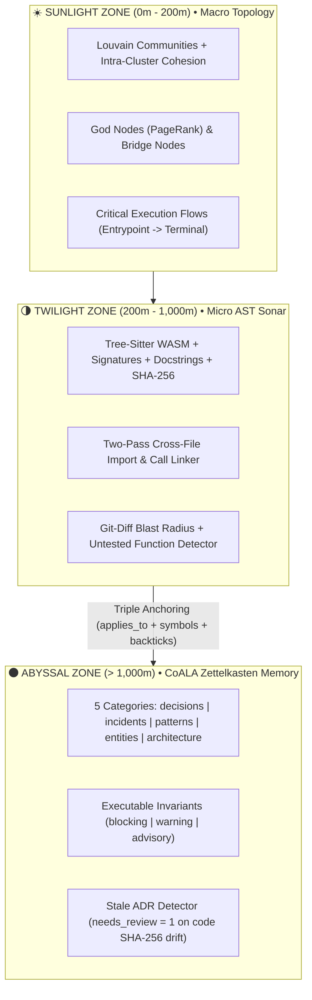

# 🌊 Bathynaut v0.2 SOTA
### The Unified Oceanic Cognitive Architecture & Memory Harness for AI Coding Agents

[](https://github.com/miguelarc/bathynaut)
[](https://opensource.org/licenses/MIT)
[](https://nodejs.org)
[](https://www.typescriptlang.org)
[](https://modelcontextprotocol.io)

> **Stop letting your AI coding agent drown in tokens.**
> Giving an agent a 1M-token context window to explore a 100k-line codebase is like throwing someone into the Mariana Trench with a snorkel.
>
> **Bathynaut v0.2 SOTA** equips your agent with an indestructible deep-sea submersible: **Two-Pass Cross-File AST Sonar**, **Louvain Topological Clustering + Execution Flows**, and a **CoALA Zettelkasten Causal Memory Vault** with **Hybrid RRF Search** and **Token-Budgeted Excerpt Packing**—all in a single zero-API-cost TypeScript package.

---

## ⚡ Quick Start (Any Repository in 3 Seconds)

```bash
npx bathynaut init
```

In a single command, Bathynaut:
1. **Detects** your installed AI coding agents (**Claude Code**, **Cursor**, **Antigravity**, **Windsurf**, **GitHub Copilot**).
2. **Scaffolds** the CoALA Zettelkasten vault (`.bathynaut/memory/` or adopts an existing `.agents/memory/` vault natively) with 5 cognitive categories and Obsidian Graph View presets.
3. **Backs up & Injects** the 3-Phase Oceanic Pair-Programming Protocol (`<!-- BATHYNAUT:START/END -->`) into your agent rules (`CLAUDE.md`, `.cursorrules`, `AGENTS.md`) and registers the MCP server.
4. **Parses & Links** your codebase AST via `web-tree-sitter` (WASM) with Two-Pass Cross-File Symbol & Import Resolution, traces **Execution Flows**, computes **PageRank God Nodes** & **Louvain Cohesion**, and exports the interactive `.bathynaut/bathynaut.html` visual explorer.

---

## 🏆 Why Bathynaut SOTA? (Architectural Comparison vs. The Knowledge Graph Ecosystem)

We engineered Bathynaut by synthesizing and surpassing the strongest capabilities from **`zk-wiki-mcp`**, **`code-review-graph`**, **`graphify`**, and **`graphicle`** into a single unified engine:

| Capability | ZK-Wiki MCP | Code-Review-Graph | Graphify | Graphicle | **Bathynaut SOTA** |
| :--- | :---: | :---: | :---: | :---: | :---: |
| **Runtime & Portability** | TypeScript | Python (`pipx`) | Python | Python | **100% TypeScript / Node.js (`npx`, WASM + SQLite)** |
| **Cross-File AST Call & Import Resolution** | ❌ None | ✅ Strong | ⚠️ Partial | ❌ Basic | **✅ Two-Pass Symbol & Import Linker (`EXTRACTED` / `INFERRED`)** |
| **Execution Flow Tracing (Entrypoint → Leaf)** | ❌ None | ✅ `flows` | ❌ No | ❌ No | **✅ Criticality-Scored Execution Flows + `flow_memberships`** |
| **Git Diff Line-Level Blast Radius + Risk Score** | ❌ None | ✅ Yes | ❌ No | ❌ No | **✅ `git diff --unified=0` Hunk Mapping + Risk Score `[0..1]`** |
| **Macro Topology, Surprising Connections & Gaps** | ❌ None | ⚠️ Basic | ✅ Strong | ✅ Strong | **✅ Louvain Cohesion + Bridge Nodes + Architectural Drift + Knowledge Gaps** |
| **Causal Memory (CoALA + Zettelkasten + ADRs)** | ✅ Strong (4 cats) | ❌ None | ⚠️ Flat Wiki | ❌ None | **✅ 5-Category CoALA Vault + 10 Bidirectional Semantic Edges** |
| **Physical `.md` Frontmatter Mutation on `supersedes`** | ✅ Yes | ❌ None | ❌ None | ❌ None | **✅ Rewrites Old `.md` (`status: superseded` + `superseded_by`) + SQLite** |
| **Declarative Upsert (`id`), `sources` (`raw/`) & Batch `ids` Read** | ✅ Yes | ❌ None | ❌ None | ❌ None | **✅ Full Parity (`id`, `sources`, `uncompiled_raw_sources`, `ids` batch)** |
| **Executable Invariants & Stale ADR Detection** | ❌ None | ❌ None | ❌ None | ❌ None | **✅ `blocking \| warning \| advisory` + SHA-256 Stale ADR Flagging** |
| **Deterministic Symbol Rename Preview & Large Functions** | ❌ None | ✅ `refactor_tool` | ❌ None | ❌ None | **✅ `rename_symbol` Cross-File Preview + `large_functions` Detector** |
| **Search Engine** | FTS5 BM25 | FTS5 | Substring | BM25 + RRF | **✅ Hybrid RRF (FTS5 BM25 + Identifier Tokenizer + PageRank + Backlinks + `cross_repo`)** |
| **3-Column IDE Visual Debugger (`bathynaut.html`)** | ✅ 3-Column | ❌ None | ⚠️ Basic | ❌ None | **✅ 3-Column IDE (Sonar Glob Simulator + Animated Particles + Breadcrumbs)** |

---

## 🧭 The 3 Oceanic Depth Zones



---

## 🧠 CoALA Cognitive Ontology & 10 Bidirectional Semantic Edges

Inspired by **CoALA (Cognitive Architectures for Language Agents, Sumers et al., 2024)**, **MADR v4**, and **Nygard ADRs**, Bathynaut structures long-term engineering memory into **4 Memory Systems** and **5 Zettelkasten Categories**:

### 1. The 4 Memory Systems
- **Working / Episodic Memory (`activeContext.md`)**: Hot session state, current progress, and next tasks (`bathynaut_checkpoint`).
- **Semantic / Procedural Memory (`wiki/`)**: Atomic Markdown notes organized into 5 categories:
  - `wiki/decisions/` (`kind: adr`) — Architectural Decisions, trade-offs, and invariants.
  - `wiki/incidents/` (`kind: incident`) — Postmortems, root causes, and regressions.
  - `wiki/patterns/` (`kind: pattern`) — Idiomatic conventions, recipes, and anti-patterns.
  - `wiki/entities/` (`kind: entity`) — Core domain models, bounded contexts, and external APIs.
  - `wiki/architecture/` (`kind: architecture`) — High-level subsystem designs and C4 topologies.
- **Navigation Hub (`index.md`)**: Auto-generated Map of Content (MOC) grouped by category, status, and alert flags.
- **Ingestion Staging (`raw/`)**: Uncompiled notes, RFC drafts, and logs audited by `bathynaut_lint`.

### 2. The 10 Bidirectional Semantic Relations
Every semantic edge written via YAML frontmatter or inline Dataview syntax (`relation:: [[target-id]]`) automatically materializes its inverse in `bathynaut_recall` backlinks:

| Forward Edge (`source -> target`) | Inverse Backlink (`target <- source`) | Engineering Semantics |
| :--- | :--- | :--- |
| **`supersedes`** | `superseded_by` | Temporal ADR lineage; automatically marks old ADR as `status: superseded`. |
| **`mitigates`** | `mitigated_by` | Links a decision or pattern to the incident/risk it prevents. |
| **`caused_by`** | `caused_incident` | Connects an incident to the root-cause module or legacy ADR. |
| **`depends_on`** | `required_by` | Structural or architectural dependency between decisions/modules. |
| **`implements`** | `implemented_by` | Links concrete patterns or modules to architectural specs. |
| **`tensions_with`** | `tensions_with` | Explicit trade-off tension (e.g., Latency vs. Consistency). |
| **`verified_by`** | `verifies` | Connects an ADR invariant to the automated test suite enforcing it. |
| **`mentions`** | `mentioned_in` | Standard `[[wikilink]]` with extracted surrounding paragraph context. |
| **`shares_scope_with`** | `shares_scope_with` | Auto-inferred (`INFERRED`) when two active notes share overlapping `applies_to` globs. |
| **`governed_by`** | `governs` | Triple-anchored bridge between physical AST code symbols and Zettelkasten notes. |

### 3. Triple Code-to-ADR Anchoring & Stale ADR Detection
Bathynaut connects code symbols (`function`, `class`, `interface`, `file`) to Zettelkasten notes through **3 complementary anchors**:
1. **File Globs (`applies_to`)**: e.g., `applies_to: ["src/auth/**"]` (`INFERRED`).
2. **Explicit Symbol Anchors (`symbols`)**: e.g., `symbols: ["verifyToken", "AuthService.login"]` (`EXTRACTED`).
3. **Inline Backtick Mentions**: Writing `` `verifyToken()` `` in the Markdown body automatically links the note to the AST node (`INFERRED`).

When a governed function's AST `content_hash` (SHA-256) changes without a corresponding update to its governing ADR, Bathynaut flags the edge with `needs_review = 1` (`stale_warning: true`), alerting both the agent and `bathynaut doctor`.

---

## 🎯 The "Oceanic 7" Composite MCP Toolset

Bathynaut exposes 7 high-density tools designed to minimize round-trips and respect strict token budgets:

| MCP Tool | Description |
| :--- | :--- |
| **`bathynaut_sonar`** | **Pre-Edit Radar**: Accepts `files`, optional `git_diff` ref, and `token_budget`. Returns `blocking_invariants` at the top, `risk_score` (`0.0–1.0`) + `risk_level` (`LOW..CRITICAL`), `affected_nodes`, `affected_flows`, `covering_tests`, `untested_functions`, `governing_adrs`, `known_incidents`, and token-packed `excerpts`. |
| **`bathynaut_dive`** | **Macro Topology**: Returns Louvain `communities` (with intra-cluster `cohesion`), `top_god_nodes` (PageRank), `bridge_nodes`, and `top_flows`. |
| **`bathynaut_path`** | **Acoustic Pathfinding**: Bidirectional shortest path between any two symbols or notes, including step-by-step edge relations, confidence tiers, and context snippets. |
| **`bathynaut_recall`** | **Hybrid RRF Search**: Combines SQLite FTS5 BM25 (with `camelCase`/`snake_case` identifier expansion) + PageRank centrality + 1-Hop outgoing relations & inverse backlinks + deprecation warnings, packed within `token_budget`. |
| **`bathynaut_log_adr`** | **CoALA Atomic Writer + Auto-Interlinker**: Creates a new note in `decisions`, `incidents`, `patterns`, `entities`, or `architecture`, records `invariants` and `enforcement`, updates `supersedes` status, and **immediately auto-interlinks** matching code nodes in SQLite + regenerates `index.md`. |
| **`bathynaut_checkpoint`** | **Episodic Session Memory**: Persists current summary, active tasks, and turn decisions to `activeContext.md`. |
| **`bathynaut_lint`** | **5D Graph Health Audit**: Detects `orphan_nodes`, `broken_edges`, `stale_adrs`, `untested_god_nodes`, and `pending_raw_files`. |

> **Multi-Project Ready**: Every MCP tool accepts an optional `project_path` parameter, dynamically routing through Bathynaut's LRU `ProjectContextPool` and running `<50ms` Just-in-Time incremental sync (`ensureFreshGraph`).

---

## 🤖 Universal Multi-Agent Harness (Hooks, Skills, Rules & MCP)

Running `npx bathynaut init` configures the entire cognitive harness across the major AI coding agents with automatic `.bak` backups in `.bathynaut/backups/` and 1-command rollback (`npx bathynaut disconnect`):

| Agent Platform | MCP Server Config (`-d <repo>` pinned) | Rules & Progressive Disclosure Includes | Auto-Discovered Skills (6 Workflows) | Agent Lifecycle & Git Hooks |
| :--- | :--- | :--- | :--- | :--- |
| **Antigravity** | `~/.gemini/antigravity/mcp_config.json` | `AGENTS.md`, `GEMINI.md`, `.agents/rules/bathynaut.md` (with `@[Contexto Ativo](.bathynaut/memory/activeContext.md)` & `@[Indice da Wiki](.bathynaut/memory/index.md)`) | `.agents/skills/bathynaut-*/SKILL.md` | `.agents/hooks.json` (`SessionStart`, `PreToolUse`) |
| **Claude Code** | `.mcp.json` (project) + `~/.claude.json` | `CLAUDE.md` (with `@.bathynaut/memory/activeContext.md` & `@.bathynaut/memory/index.md`) | `.claude/skills/bathynaut-*/SKILL.md` | `.claude/settings.json` (`SessionStart`, `PreToolUse`) |
| **Cursor** | `.cursor/mcp.json` | `.cursor/rules/bathynaut.mdc` (`alwaysApply: true`, `globs: "**/*"`) + `.cursorrules` | `.cursor/skills/bathynaut-*/SKILL.md` | `.cursor/hooks.json` (`beforeShellExecution`) |
| **Windsurf** | `~/.codeium/windsurf/mcp_config.json` | `.windsurfrules` + `AGENTS.md` | `.agents/skills/bathynaut-*/SKILL.md` | Git `post-merge`, `post-commit`, `post-checkout` |
| **GitHub Copilot** | `.vscode/mcp.json` (`"servers"` + `"type": "stdio"`) | `.github/copilot-instructions.md` | `.agents/skills/bathynaut-*/SKILL.md` | Git `post-merge`, `post-commit`, `post-checkout` |
| **Gemini CLI** | `.gemini/settings.json` | `GEMINI.md` | `.agents/skills/bathynaut-*/SKILL.md` | `.gemini/settings.json` (`SessionStart`, `PreToolUse`) |
| **OpenCode / Codex** | `opencode.json` (`"mcp"` local) | `AGENTS.md` | `.agents/skills/bathynaut-*/SKILL.md` | Git `post-merge`, `post-commit`, `post-checkout` |

### Built-in Cognitive Skills (Installed Automatically)
1. **`bathynaut-map-project`**: 6-Domain Deep Architecture & CoALA Zettelkasten Mapping (`bathynaut_dive` + `bathynaut_log_adr` + `bathynaut_lint`).
2. **`bathynaut-wiki-compile`**: Compiles raw documents from `.bathynaut/memory/raw/` into atomic Zettelkasten notes with `sources` and typed edges.
3. **`bathynaut-wiki-lint`**: 5D Graph Health Audit (`orphan_active_notes`, `dangling_links`, `stale_adrs`, `untested_god_nodes`, `uncompiled_raw_sources`).
4. **`bathynaut-session-checkpoint`**: Persists hot episodic session state (`activeContext.md`) & compiles session learnings.
5. **`bathynaut-review-changes`**: Pre-commit / PR Blast Radius & Risk Score Review (`bathynaut_sonar({ git_diff: "HEAD" })`).
6. **`bathynaut-refactor-safely`**: Safe Cross-File Symbol Refactoring & `blocking_invariants` Verification.

---

## 🛠️ CLI Reference

```bash
# 1. Initialize vault, agent rules, skills, lifecycle hooks, MCP config, and map repository
npx bathynaut init

# 2. Incremental AST + Zettelkasten sync (<50ms if unchanged; --force for full rebuild)
npx bathynaut map [--force]

# 3. Pre-commit / Pre-PR Risk & Blast Radius Audit (supports Git diff refs)
npx bathynaut review [files...] [--base HEAD] [--token-budget 2500] [--json]

# 4. Launch the interactive D3.js Ocean Canvas Explorer in your browser
npx bathynaut explore

# 5. Run the 5D Graph & Memory Health Audit
npx bathynaut doctor

# 6. Install or remove Git hooks + Agent Lifecycle Hooks
npx bathynaut hooks [install|uninstall]

# 7. Fast (<15ms) Agent Lifecycle Hook evaluator (invoked automatically by SessionStart / PreToolUse)
npx bathynaut hook-guard --event <SessionStart|PreToolUse>

# 8. Safely remove injected agent rules, skills, hooks & MCP entries while preserving .bathynaut/memory/
npx bathynaut disconnect

# 9. Run the MCP server over stdio
npx bathynaut serve
```

---

## 📄 License

MIT © Miguel Arc & Antigravity
