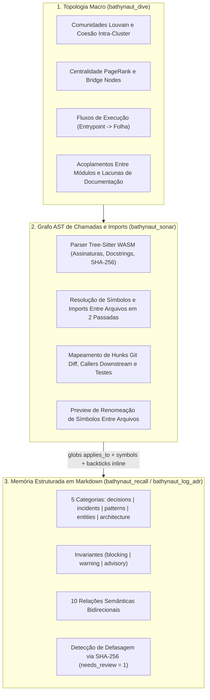

<p align="center">
  
</p>

# Bathynaut

> **Impeça que agentes de IA quebrem sua arquitetura ou esqueçam decisões técnicas passadas.**

**Grafo AST de código, analisador topológico e servidor de memória ADR/Zettelkasten local (MCP) para agentes de IA.**

[English](README.md) | [Português (Brasil)](README.pt-BR.md)

[](https://github.com/miguelarcjr/bathynaut)
[](LICENSE)
[-16a34a?style=flat-square)](https://nodejs.org)
[](https://www.typescriptlang.org)
[](https://modelcontextprotocol.io)

---

## Sumário

- [Visão Geral e Objetivos de Projeto](#visão-geral-e-objetivos-de-projeto)
- [Início Rápido](#início-rápido)
- [Arquitetura](#arquitetura)
- [Vault de Memória e Relações Semânticas](#vault-de-memória-e-relações-semânticas)
- [Referência das Ferramentas MCP](#referência-das-ferramentas-mcp)
- [Integração com Agentes (Rules, Skills e Hooks)](#integração-com-agentes-rules-skills-e-hooks)
- [Explorador Visual do Grafo (`bathynaut.html`)](#explorador-visual-do-grafo-bathynauthtml)
- [Referência da CLI](#referência-da-cli)
- [Perguntas Frequentes (FAQ)](#perguntas-frequentes-faq)
- [Licença](#licença)

---

## Visão Geral e Objetivos de Projeto

### O Problema que o Bathynaut Resolve

Quando um agente de codificação (Antigravity, Claude Code, Cursor, Windsurf, Copilot) edita arquivos em repositórios reais, ele enfrenta dois pontos cegos críticos:
1. **Cegueira Estrutural**: Buscas textuais (`grep`) ou leitura de trechos isolados não revelam quais chamadores transitivos, fluxos de execução ou testes serão quebrados em outros módulos antes da edição ser feita.
2. **Amnésia entre Sessões**: Decisões arquiteturais, invariantes de segurança e correções de bugs passados documentados em Markdown raramente ficam conectados às funções e arquivos específicos que governam — fazendo o agente reintroduzir regressões já resolvidas.

### Como o Bathynaut Resolve (Em 1 Comando)

O Bathynaut equipa seu agente com **visão estrutural local** e **memória causal persistente** por meio de ferramentas nativas do Model Context Protocol (MCP) e hooks de ciclo de vida:

- 📡 **Radar Pré-Edição (`bathynaut_sonar`)**: Antes de salvar um arquivo, o agente recebe automaticamente o raio de impacto (*blast radius* AST), a cadeia de chamadores, a cobertura de testes e os invariantes obrigatórios daquela área (`blocking_invariants`).
- 🗺️ **Topologia de Módulos (`bathynaut_dive`)**: Mapeia clusters funcionais (comunidades Louvain) e pontos de gravidade do código (God Nodes via PageRank), fazendo o agente respeitar as fronteiras entre subsistemas em vez de criar acoplamentos indevidos.
- 🧠 **Memória Viva de Decisões (`bathynaut_recall` / `bathynaut_log_adr`)**: Conecta registros de decisão arquitetural (ADRs), padrões e incidentes passados diretamente aos símbolos de código correspondentes (`applies_to`, `symbols` e menções inline `` `simbolo()` ``), com detecção automática de defasagem (`needs_review`).

### O Ganho na Prática

- ⚡ **Drástica redução no consumo de tokens e latência**: Em vez do agente gastar dezenas de chamadas de `grep` e leitura de arquivos inteiros tentando adivinhar dependências, uma única chamada entrega exatamente as assinaturas, chamadores e decisões relevantes dentro de um orçamento estrito (`token_budget`).
- 🛡️ **Refatorações seguras e menos regressões**: O agente enxerga de antemão todos os pontos impactados, o nível de risco da alteração e quais testes cobrem (ou faltam cobrir) a função antes de modificá-la.
- 🔄 **Zero repetição de contexto entre sessões e editores**: Você para de reexplicar as mesmas regras de negócio a cada novo chat — o contexto ativo (`activeContext.md`) e os invariantes de arquitetura acompanham o repositório no Antigravity, Claude Code, Cursor, Windsurf, Gemini CLI e Copilot.
- 📐 **Documentação que não apodrece em silêncio**: Como as notas de decisão são ancoradas nos nós da AST, qualquer alteração em uma função governada marca automaticamente a ADR para revisão (`needs_review`).

**100% determinístico, offline e privado.** Zero chamadas a APIs externas e zero chunks vetoriais arbitrários — tudo reside em um único banco SQLite local (`.bathynaut/ocean.db`) com `web-tree-sitter` (WASM), busca híbrida FTS5 BM25 + PageRank e TypeScript puro.

| Dimensão | Grafos Apenas de AST | Servidores de Notas Markdown | Bathynaut |
| :--- | :--- | :--- | :--- |
| **Foco Principal** | Grafo de chamadas/imports, clusters, blast radius | ADRs, notas de sessão, wikilinks | Grafo AST unificado + memória estruturada ADR/Zettelkasten |
| **Runtime** | Python (`uv`/`pipx`) ou binários nativos | Node.js ou Python | Node.js / TypeScript (`web-tree-sitter` WASM + SQLite) |
| **Superfície MCP** | 10–28 tools | 4–8 tools | 7 tools consolidadas (`sonar`, `dive`, `path`, `recall`, `log_adr`, `checkpoint`, `lint`) |
| **Vínculo Código ↔ Decisão** | Nenhum | Apenas globs de caminho de arquivo | Globs (`applies_to`), lista explícita de `symbols` e menções inline `` `simbolo()` `` |
| **Detecção de Defasagem** | Reindexação de AST | Manual | Marca ADRs como `needs_review` quando o SHA-256 da função governada muda |

---

## Início Rápido

### 🤖 O Jeito Mais Fácil: Prompt de Auto-Configuração para Agentes

Basta copiar e colar o prompt abaixo diretamente no chat do seu agente de IA (Claude Code, Cursor, Antigravity, Windsurf, Copilot). O próprio agente cuidará de rodar a inicialização, validar os arquivos gerados e configurar o MCP automaticamente:

<details open>
<summary><b>Prompt de Instalação para Agentes de IA (Clique para recolher)</b></summary>

```markdown
Instale e inicialize o Bathynaut neste repositório seguindo estes passos:

1. Inicialização:
   - Execute `npx bathynaut init -d "."` na raiz do repositório (ou, a partir de um clone local do Bathynaut, compile com `npm run build` e execute `node <caminho-do-bathynaut>/dist/cli/main.js init -d "."`).

2. Verificação da estrutura gerada:
   - Vault de memória em `.bathynaut/memory/` (ou `.agents/memory/`) contendo `activeContext.md`, `index.md` e `wiki/{decisions,incidents,patterns,entities,architecture}`.
   - Banco SQLite `.bathynaut/ocean.db` e visualizador HTML `.bathynaut/bathynaut.html`.
   - Regras do agente (`AGENTS.md`, `GEMINI.md`, `CLAUDE.md`, `.cursor/rules/bathynaut.mdc`), skills (`.agents/skills/bathynaut-*`) e hooks.

3. Diagnóstico inicial:
   - Execute `npx bathynaut doctor` (ou chame as tools `bathynaut_lint` e `bathynaut_dive`) e apresente um resumo dos módulos detectados, pontos de entrada e eventuais subsistemas sem documentação.
```

</details>

### Ou Execute Manualmente via Terminal

```bash
cd seu-projeto
npx bathynaut init
```

O comando `bathynaut init` executa quatro etapas:
1. **Inicializa o vault de memória em Markdown** em `.bathynaut/memory/` (ou adota automaticamente um diretório `.agents/memory/` já existente).
2. **Configura os clientes de IA detectados** (Antigravity, Claude Code, Cursor, Windsurf, GitHub Copilot, Gemini CLI, OpenCode), criando cópias de segurança `.bak` em `.bathynaut/backups/` antes de modificar qualquer arquivo.
3. **Instala skills e hooks de ciclo de vida** (`SessionStart` para contexto de sessão, `PreToolUse` para alertar sobre invariantes ativos nos arquivos editados, além de hooks Git `post-commit`/`post-merge`).
4. **Indexa o repositório em `.bathynaut/ocean.db`** e exporta o visualizador interativo em `.bathynaut/bathynaut.html`.

### Tarefas Comuns

| Objetivo | Comando no Terminal | Prompt / Skill no Agente |
| :--- | :--- | :--- |
| Inicializar um repositório | `npx bathynaut init` | *"Execute `bathynaut init` neste repositório"* |
| Sincronizar arquivos modificados incrementalmente | `npx bathynaut map` | Automático nas chamadas MCP e hooks Git |
| Verificar blast radius e invariantes de um diff | `npx bathynaut review` | *"Use `bathynaut-review-changes` para revisar meu diff atual"* |
| Abrir o visualizador local D3.js no navegador | `npx bathynaut explore` | *"Execute `npx bathynaut explore`"* |
| Mapear arquitetura e lacunas de documentação | — | *"Execute a skill `bathynaut-map-project`"* |
| Compilar rascunhos de `raw/` em notas estruturadas | — | *"Execute `bathynaut-wiki-compile`"* |
| Auditar integridade do grafo (órfãos, links quebrados, ADRs defasadas) | `npx bathynaut doctor` | *"Execute `bathynaut-wiki-lint`"* |
| Salvar o estado da sessão em `activeContext.md` | — | *"Execute `bathynaut-session-checkpoint`"* |
| Remover rules, hooks e configs MCP injetados | `npx bathynaut disconnect` | *"Execute `npx bathynaut disconnect`"* |

---

## Arquitetura

O Bathynaut modela o repositório em três camadas conectadas dentro de um único banco SQLite (`ocean.db`):



---

## Vault de Memória e Relações Semânticas

### 1. Estrutura de Diretórios

Os arquivos Markdown permanecem como a fonte da verdade em disco; o SQLite atua como índice relacional e FTS5 derivado:

```text
.bathynaut/
├── ocean.db                  # Banco SQLite (nós, arestas, índice FTS5, comunidades, fluxos)
├── bathynaut.html            # Explorador visual D3.js standalone
├── backups/                  # Cópias .bak automáticas dos arquivos de configuração alterados
└── memory/
    ├── activeContext.md      # Estado de trabalho da sessão atual e próximas tarefas
    ├── index.md              # Map of Content (MOC) gerado automaticamente
    ├── raw/                  # Rascunhos, RFCs ou logs ainda não compilados
    ├── .obsidian/graph.json  # Configuração opcional de cores para o Obsidian Graph View
    └── wiki/
        ├── decisions/        # Registros de Decisão Arquitetural (kind: adr)
        ├── incidents/        # Postmortems e causas-raiz de bugs (kind: incident)
        ├── patterns/         # Convenções reutilizáveis e anti-padrões (kind: pattern)
        ├── entities/         # Modelos centrais de domínio (kind: entity)
        └── architecture/     # Visão geral de subsistemas (kind: architecture)
```

### 2. Arestas Semânticas Bidirecionais

As relações podem ser declaradas no frontmatter YAML (`edges: { mitigates: ["inc-001"] }`) ou inline no corpo Markdown (`mitigates:: [[inc-001]]`). Nas consultas via `bathynaut_recall`, tanto as arestas de saída quanto os backlinks inversos são retornados:

| Relação Direta (`source -> target`) | Backlink Inverso (`target <- source`) | Finalidade |
| :--- | :--- | :--- |
| `supersedes` | `superseded_by` | Substitui uma ADR anterior e atualiza o `.md` antigo em disco (`status: superseded`). |
| `mitigates` | `mitigated_by` | Conecta uma decisão ou padrão ao incidente/bug que ele previne. |
| `caused_by` | `caused_incident` | Conecta um incidente à sua causa-raiz. |
| `depends_on` | `required_by` | Declara dependência entre decisões, padrões ou módulos. |
| `implements` | `implemented_by` | Conecta um módulo ou padrão concreto a uma especificação arquitetural. |
| `tensions_with` | `tensions_with` | Registra um trade-off explícito entre duas decisões. |
| `verified_by` | `verifies` | Conecta uma ADR ou invariante à suíte de testes correspondente. |
| `mentions` | `mentioned_in` | Referência padrão `[[wikilink]]` com extração do parágrafo de contexto. |
| `shares_scope_with` | `shares_scope_with` | Inferida automaticamente quando duas notas ativas possuem globs `applies_to` sobrepostos. |
| `governed_by` | `governs` | Conecta símbolos da AST às notas/ADRs que os governam. |

---

## Referência das Ferramentas MCP

| Tool | Parâmetros | Descrição |
| :--- | :--- | :--- |
| **`bathynaut_sonar`** | `files`, `git_diff`, `token_budget`, `project_path` | **Análise de impacto pré-edição**: Retorna `blocking_invariants`, `risk_score` (`0..1`), `affected_nodes`, `affected_flows`, `covering_tests`, `untested_functions`, `governing_adrs`, `known_incidents` e trechos de código ajustados ao `token_budget`. |
| **`bathynaut_dive`** | `community_id`, `query`, `rename_symbol`, `new_name`, `project_path` | **Topologia macro**: Retorna `communities` Louvain (com `cohesion`), `top_god_nodes` (PageRank), `bridge_nodes`, `top_flows`, `surprising_connections`, `knowledge_gaps`, `large_functions` e `rename_preview`. |
| **`bathynaut_path`** | `from`, `to`, `project_path` | **Caminho mais curto**: Busca em largura bidirecional entre quaisquer dois símbolos ou notas, indicando relações e nível de confiança (`EXTRACTED` / `INFERRED`). |
| **`bathynaut_recall`** | `query`, `ids`, `category`, `include_superseded`, `cross_repo`, `limit`, `token_budget`, `project_path` | **Busca híbrida e leitura em lote**: Combina FTS5 BM25 (com separação de `camelCase`/`snake_case`), PageRank e backlinks de 1 salto via Reciprocal Rank Fusion (RRF), além de leitura direta por `ids`. |
| **`bathynaut_log_adr`** | `id`, `title`, `summary`, `category`, `context`, `decision`, `enforcement`, `invariants`, `applies_to`, `symbols`, `sources`, `edges`, `project_path` | **Compilador de notas**: Cria ou atualiza uma nota Markdown validada, atualiza arquivos `.md` substituídos em disco, vincula símbolos AST no SQLite e regenera o `index.md`. |
| **`bathynaut_checkpoint`** | `summary`, `active_tasks`, `decisions`, `project_path` | **Checkpoint de sessão**: Persiste o resumo do progresso atual e as próximas tarefas em `activeContext.md`. |
| **`bathynaut_lint`** | `project_path` | **Auditoria de integridade**: Reporta `orphan_active_notes`, `dangling_links`, `stale_adrs`, `untested_god_nodes` e `uncompiled_raw_sources`. |

---

## Integração com Agentes (Rules, Skills e Hooks)

| Cliente | Configuração MCP | Arquivo de Regras | Diretório de Skills | Hooks |
| :--- | :--- | :--- | :--- | :--- |
| **Antigravity** | `~/.gemini/antigravity/mcp_config.json` | `AGENTS.md`, `.agents/rules/bathynaut.md` | `.agents/skills/bathynaut-*/SKILL.md` | `.agents/hooks.json` (`SessionStart`, `PreInvocation`, `PreToolUse`, `PostToolUse`) |
| **Claude Code** | `.mcp.json` + `~/.claude.json` | `CLAUDE.md` | `.claude/skills/bathynaut-*/SKILL.md` | `.claude/settings.json` (`SessionStart`, `UserPromptSubmit`, `PreToolUse`, `PostToolUse`) |
| **Cursor** | `.cursor/mcp.json` | `.cursor/rules/bathynaut.mdc` + `.cursorrules` | `.cursor/skills/bathynaut-*/SKILL.md` | `.cursor/hooks.json` (`beforeSubmitPrompt`, `beforeShellExecution`, `afterFileEdit`) |
| **Windsurf** | `~/.codeium/windsurf/mcp_config.json` | `.windsurfrules` + `AGENTS.md` | `.agents/skills/bathynaut-*/SKILL.md` | Git `post-merge`, `post-commit`, `post-checkout` |
| **GitHub Copilot** | `.vscode/mcp.json` | `.github/copilot-instructions.md` | `.agents/skills/bathynaut-*/SKILL.md` | Git `post-merge`, `post-commit`, `post-checkout` |
| **Gemini CLI** | `.gemini/settings.json` | `GEMINI.md` | `.agents/skills/bathynaut-*/SKILL.md` | `.gemini/settings.json` (`SessionStart`, `BeforeAgent`, `PreToolUse`, `PostToolUse`) |
| **OpenCode** | `opencode.json` | `AGENTS.md` | `.agents/skills/bathynaut-*/SKILL.md` | Git `post-merge`, `post-commit`, `post-checkout` |

---

## Explorador Visual do Grafo (`bathynaut.html`)

Execute `npx bathynaut explore` para gerar e abrir `.bathynaut/bathynaut.html` no navegador. Trata-se de um arquivo HTML autocontido com D3.js:

- **Barra Lateral Esquerda**: Simulador de Glob do Sonar (digite um caminho de arquivo ou glob para destacar os símbolos e ADRs aplicáveis), filtros por tipo de nó e lista ordenada por PageRank.
- **Canvas Central D3.js**: Layout de força dividido em três faixas horizontais (`Sunlight` para topologia/entrypoints, `Twilight` para símbolos AST e `Abyssal` para notas Markdown), com modos **Smart Overview (Top 250)**, **Extended Graph (Top 500)**, **1-Hop Ego**, **2-Hop Blast** e **All Nodes**.
- **Painel Inspetor Direito**: Exibe metadados do nó, assinatura de funções, invariantes, chips clicáveis de `[[wikilinks]]`, arestas de saída, backlinks e código-fonte ou conteúdo Markdown.

---

## Referência da CLI

```bash
npx bathynaut init [-d <dir>]
npx bathynaut map [-d <dir>] [--force]
npx bathynaut review [files...] [-d <dir>] [--base HEAD] [--token-budget 2500] [--json]
npx bathynaut explore [-d <dir>]
npx bathynaut doctor [-d <dir>]
npx bathynaut hooks [install|uninstall] [-d <dir>]
npx bathynaut hook-guard --event <SessionStart|PreToolUse> [-d <dir>]
npx bathynaut disconnect [-d <dir>]
npx bathynaut serve [-d <dir>]
```

---

## Perguntas Frequentes (FAQ)

**O Bathynaut faz chamadas externas ou exige chave de API de LLM?**  
Não. O parser (`web-tree-sitter`), a clusterização (`graphology`) e a busca textual (SQLite FTS5) rodam localmente na máquina.

**E se o módulo nativo `better-sqlite3` não compilar no meu ambiente?**  
O arquivo `src/storage/db.ts` utiliza automaticamente o módulo nativo `node:sqlite` (`DatabaseSync`, disponível no Node 22+) caso `better-sqlite3` não esteja disponível.

**O Bathynaut suporta múltiplos repositórios ao mesmo tempo?**  
Sim. O servidor MCP mantém um pool LRU (`ProjectContextPool`) e resolve o repositório alvo a partir de `project_path`, `workspace_hint` ou qualquer caminho absoluto informado nas chamadas.

---

## Licença

MIT © Miguel Junior
